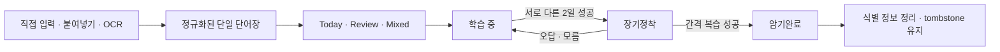
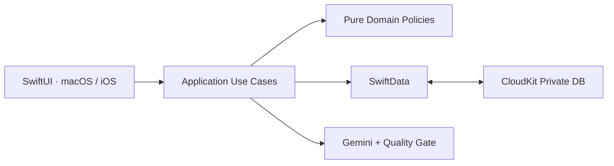

<div align="center">

# Vocab Officer

**입력부터 장기 기억까지 이어 주는 macOS · iOS 네이티브 영단어 학습 앱**


</div>

Vocab Officer는 많은 단어를 빠르게 등록하고, 필요한 단어를 제때 복습하며,
Mac과 iPhone에서 학습을 이어 가기 위해 만든 개인용 제품입니다. 날짜별 단어 세트를
쌓는 대신 **하나의 정규화된 단어장**을 유지하고, 같은 표제어가 다시 들어오면 새로운
뜻만 기존 원본(SOT)에 병합합니다.

## 주요 기능

- **제한 없는 단어 등록**: 직접 입력, 일괄 붙여넣기, 여러 이미지의 Vision OCR을
  지원합니다. 인쇄 번호가 다시 시작되거나 행이 누락된 입력도 진단하며, 등록 개수에
  인위적인 상한을 두지 않습니다.
- **세 가지 학습 모드**: Today는 가장 최근 등록일의 단어를, Review는 복습 우선순위가
  높은 단어를, Mixed는 전체 단어장을 공정하게 순환합니다. 세션은 중복 없이 최대
  20문항으로 구성됩니다.
- **양방향·다형식 테스트**: 영→한·한→영 주관식과 4지선다를 지원합니다. 자동 판정을
  직접 보정하거나 정답 별칭을 추가할 수 있고, 각 뜻의 학습 상태를 따로 추적합니다.
- **장기 기억 수명주기**: 서로 다른 날짜의 성공 기록을 바탕으로 `학습 중` →
  `장기정착` → `암기완료`를 판정합니다. 장기정착 단어는 간격을 둔 유지 복습에 다시
  등장하며, 최종 암기완료 데이터는 식별 정보를 지우고 삭제 정보만 남겨 동기화 과정의
  재등장을 방지합니다.
- **AI 암기 도움**: Gemini로 어원, 연상법, 예문, 유사어 비교를 생성합니다. 응답 품질
  검증, 제한적 재시도, 모델 fallback, quota cooldown, 결과 캐시를 포함합니다.
- **로컬 우선 학습 연속성**: SwiftData를 기기별 오프라인 원본으로 사용하고 private
  CloudKit에서 레코드 단위로 조정합니다. iPhone은 이동 중 단어장·복습·테스트에
  집중하고, OCR 등록과 대규모 편집, AI 설정은 Mac 중심으로 제공합니다.
- **네이티브 접근성**: 플랫폼별 SwiftUI 화면, 플립 카드, VoiceOver, macOS 키보드 중심
  테스트 흐름을 제공합니다.

## 학습 흐름



Today는 오늘 등록한 단어가 없으면 가장 최근 등록일을 사용합니다. Mixed는 학습 이력이
적은 단어를 우선하면서 복습, 장기정착 유지, 전체 단어장 순환을 제한된 quota로
조합합니다. 같은 날 아직 보지 않은 단어가 남아 있으면 이미 출제된 단어를 먼저
반복하지 않습니다.

## 설계



도메인 정책을 UI, 영속성, 외부 서비스와 분리한 Clean Architecture를 적용했습니다.
동기화와 AI 요청은 UI 지연 경로에서 분리하고, 요약 상태와 캐시를 사용해 전체 학습
이력의 반복 스캔을 피합니다. 프로젝트 계약은 [`CLAUDE.md`](CLAUDE.md), 영역별
설계 규칙은 [`.claude/rules/`](.claude/rules/)에서 확인할 수 있습니다.

## 실행하기

### 요구 환경

- Xcode 26+
- macOS 26+ 또는 iOS 26+
- iCloud 동기화 사용 시 Apple Development Team과
  `iCloud.com.swainyun.Vocab` 컨테이너
- AI 암기 도움 사용 시 Google AI Studio에서 발급한 Gemini API 키(선택)

```bash
git clone git@github.com:Remaked-Swain/Vocab-Officer.git
cd Vocab-Officer

# macOS 단위 테스트
xcodebuild -project Vocab.xcodeproj -scheme Vocab \
  -destination 'platform=macOS' CODE_SIGNING_ALLOWED=NO test

# Release 빌드 후 /Applications/Vocab.app에 설치하고 실행
./script/build_and_run.sh --install-verify
```

iOS companion 타깃은 `VocabIOS`입니다. Xcode에서 개발 팀과 실기기를 선택해 실행할 수
있습니다. CloudKit 전환은 계정, entitlement, 스키마, 기존 데이터 checkpoint가 모두
검증된 경우에만 열리며, 준비되지 않았을 때는 로컬 저장소를 그대로 사용합니다.

Gemini API 키는 앱의 **설정**에서 입력하며 Keychain에 저장됩니다. AI 기능은 선택
사항이므로 키가 없어도 단어 등록, 학습 카드, 테스트와 로컬 저장 기능은 사용할 수
있습니다.

## 저장소 구성

| 경로 | 역할 |
| --- | --- |
| `Vocab/Domain` | 채점, 복습, 숙달, 세션 구성 순수 정책 |
| `Vocab/Application` | 등록, 테스트, 동기화, 암기완료 정리 유스케이스 |
| `Vocab/Data` | SwiftData 레코드와 스키마 마이그레이션 |
| `Vocab/Presentation` | macOS 화면과 상호작용 |
| `VocabIOS` | iPhone companion 앱 |
| `VocabTests` | 도메인, 애플리케이션, 저장소·동기화 회귀 테스트 |
| `CLAUDE.md`, `.claude` | Claude Code 하네스: 계약, 영역 규칙, Auditor, 검증·감사 스킬, 훅 |
| `script` | Swift 스타일 검사, 성능 측정, 빌드·설치 도구 |

## 데이터와 개인정보

단어장과 학습 이력은 로컬 SwiftData 저장소에 보관되며 저장소 파일, 사용자 단어는
Git에 포함하지 않습니다. CloudKit 사용 시 사용자의 private database를
사용합니다. Gemini 무료 티어의 데이터 처리 정책은 Google 정책의 영향을 받으므로
민감한 내용을 프롬프트에 넣지 않는 것을 권장합니다.
